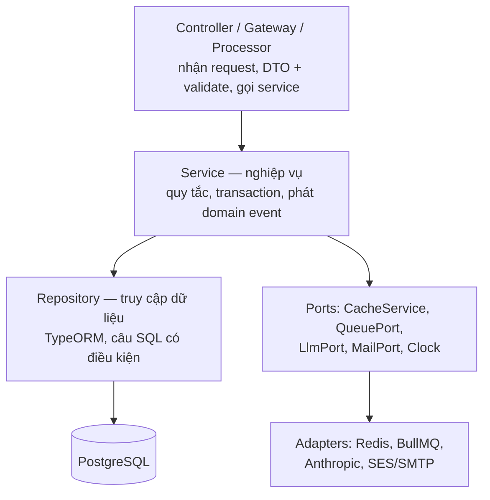
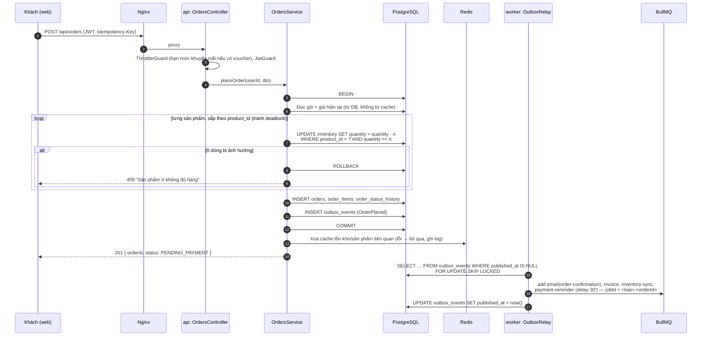
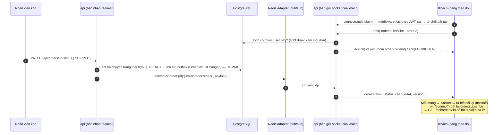
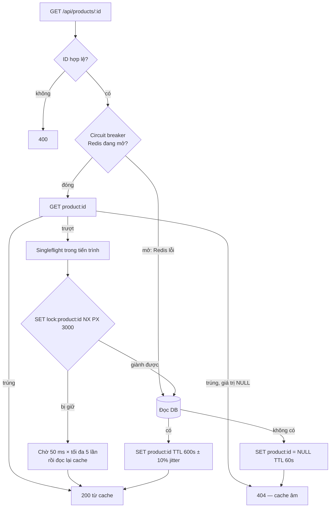

# 01 — Kiến trúc tổng thể

## 1. Kiểu kiến trúc

**Modular monolith, hai tiến trình chạy từ cùng một codebase:**

| Tiến trình | Entrypoint | Nhiệm vụ | Số bản chạy |
|------------|------------|----------|-------------|
| `api` | `src/main.ts` | REST API, WebSocket (Socket.IO), Swagger | 1 (2 trong lúc chuyển blue/green) |
| `worker` | `src/worker.ts` | Outbox relay, BullMQ processors, job theo lịch | 1 |

Module nghiệp vụ (orders, catalog…) được dùng chung; mỗi entrypoint chỉ nạp những gì nó cần (`AppModule` và `WorkerModule`).
Lý do không tách microservice: một người phát triển, một máy EC2, 200.000 khách hàng là tải mà một monolith tốt xử lý dư sức.
Tách `worker` ra tiến trình riêng để tác vụ nặng (PDF, gọi đối tác) không giành CPU của request khách và để có thể khởi động lại độc lập.

## 2. Sơ đồ triển khai trên AWS

```mermaid
flowchart LR
  user([Khách / nhân viên<br/>trình duyệt]) -->|HTTPS 443| dns[Route 53 / DNS]
  dns --> eip

  subgraph aws[AWS — ap-southeast-2 (Sydney)]
    subgraph vpc[VPC]
      subgraph pub[Public subnet]
        eip((Elastic IP))
        subgraph ec2[EC2 t3.medium — Docker Compose]
          nginx[nginx<br/>TLS, HTTP→HTTPS<br/>+ web tĩnh]
          apiB[api-blue]
          apiG[api-green]
          worker[worker]
          pg[(PostgreSQL 16<br/>volume pgdata)]
          redis[(Redis 7<br/>AOF)]
        end
      end
    end
    ssm[SSM Parameter Store<br/>SecureString]
    s3[(S3 shopfast-backups<br/>versioning + SSE)]
    ses[SES<br/>email]
    cw[CloudWatch<br/>logs + alarms]
  end

  eip --> nginx
  nginx -->|/api, /socket.io| apiB
  nginx -.->|lúc chuyển| apiG
  apiB --> pg
  apiB --> redis
  worker --> pg
  worker --> redis
  worker --> ses
  worker --> llm[(LLM API)]
  apiB --> llm
  ec2 -->|instance role| ssm
  ec2 -->|backup hằng đêm| s3

  gh[GitHub Actions<br/>build job] -->|GITHUB_TOKEN tạm| ghcr[(GHCR<br/>api, web)]
  runner[self-hosted runner<br/>trên EC2] -->|kéo job HTTPS ra ngoài| gh
  runner -->|docker pull| ghcr
  runner --> nginx
```

**Mạng & cổng:**

| Thành phần | Cổng | Phơi ra ngoài? |
|------------|------|----------------|
| nginx | 80, 443 | Có — 0.0.0.0/0 (80 chỉ để chuyển hướng 301 sang 443) |
| SSH | 22 | Chỉ IP quản trị (/32); khuyến nghị dùng thêm SSM Session Manager |
| api, worker | 3000 | Không — chỉ trong Docker network `backend` |
| PostgreSQL, Redis | 5432, 6379 | Không — không có `ports:` trong compose production, chỉ trong network `backend` |

Docker Compose production chia 2 network: `edge` (nginx ↔ api) và `backend` (api/worker ↔ pg/redis). Nginx không chạm được DB.

## 3. Bảng thành phần & lý do lựa chọn

| Thành phần | Lựa chọn | Lý do | Phương án đã cân nhắc |
|------------|----------|-------|------------------------|
| Runtime | Node.js 20 LTS, TypeScript strict | SRS bắt buộc; LTS đến 2026 | — |
| Framework | NestJS 10 | SRS; DI + module giúp tách tầng rõ, có sẵn guard/interceptor/gateway | Express thuần (thiếu cấu trúc) |
| CSDL | PostgreSQL 16 | Transaction ACID cho đặt hàng, `UPDATE … WHERE stock >= n` nguyên tử, `SKIP LOCKED` cho outbox | MySQL (không có lợi thế thêm) |
| ORM | TypeORM 0.3 + migration | Tích hợp chính thức NestJS, hỗ trợ QueryRunner/transaction, migration có version | Prisma — **nếu Module 5 đã dùng Prisma thì giữ Prisma**, kiến trúc không đổi |
| Cache / khoá / hạn mức | Redis 7 (ioredis) | Một dịch vụ phục vụ 4 nhu cầu: cache, rate limit, BullMQ, Socket.IO adapter | Memcached (không có queue/pub-sub) |
| Hàng đợi | BullMQ (`@nestjs/bullmq`) | Retry/backoff, delayed & repeatable job, `jobId` chống trùng, đã có Redis | RabbitMQ/SQS (thêm hạ tầng, không cần ở quy mô này) |
| Độ tin cậy sự kiện | Transactional outbox | Đơn hàng và sự kiện được ghi trong cùng transaction → không mất email khi Redis chết | Đẩy job ngay sau commit (mất job nếu Redis lỗi đúng lúc đó) |
| Realtime | Socket.IO 4 + `@socket.io/redis-adapter` | Tự kết nối lại, room, xác thực handshake; adapter cho phép 2 bản api (blue/green) cùng phát | WebSocket thuần (tự viết reconnect/room), SSE (một chiều, vẫn cần pub/sub) |
| Rate limit | `@nestjs/throttler` + storage Redis | Named throttlers cho từng nhóm endpoint; Redis để đếm chung giữa các bản api | Chỉ dùng Nginx `limit_req` (không biết user nào đang đăng nhập) |
| AI | LLM qua cổng `LlmPort` (mặc định Anthropic Claude, tool use) | Tool calling ổn định; adapter cho phép đổi nhà cung cấp theo khoá lớp học cấp | Gọi SDK trực tiếp trong service (khó test, khó đổi) |
| Email | SES (prod), Mailpit (local) | SES dùng IAM role của EC2 → không cần khoá SMTP dài hạn | Gmail SMTP (cần mật khẩu ứng dụng = khoá dài hạn) |
| Reverse proxy | Nginx + Let's Encrypt (certbot) | TLS, HTTP→HTTPS, upgrade WebSocket, chuyển upstream blue/green bằng reload không rớt kết nối | ALB (tốn phí, cần ≥ 2 AZ) |
| Hạ tầng chạy | 1 EC2 t3.medium + Docker Compose | SRS chỉ định; đủ RAM (4 GB) cho 2 bản api lúc chuyển + PG + Redis | ECS/EKS (quá tầm), RDS (khuyến nghị khi mở rộng) |
| Registry | GitHub Container Registry (GHCR) | Đăng nhập bằng `GITHUB_TOKEN` tự cấp cho từng job, hết hạn khi job xong | ECR (cần quyền AWS từ GitHub — OIDC bị chặn, ADR-13) |
| Secrets | SSM Parameter Store (SecureString) | Miễn phí, mã hoá KMS, đọc bằng IAM role | Secrets Manager (tốn phí, xoay vòng tự động không cần ở đây) |
| CI/CD | GitHub Actions: build trên runner GitHub, deploy trên self-hosted runner đặt tại EC2 | Không có khoá AWS nào trên GitHub; runner chỉ mở kết nối ra ngoài, không cần mở thêm cổng | OIDC + SSM (bị SCP chặn), access key IAM user hoặc SSH key trong GitHub secrets (vi phạm "không khoá dài hạn") |
| Web | React 18 + Vite + TypeScript, Tailwind + shadcn/ui | Build ra file tĩnh, Nginx phục vụ trực tiếp, không cần thêm container Node | Next.js (thêm server SSR không cần thiết) |

## 4. Kiến trúc phân tầng bên trong một module



Quy tắc phụ thuộc:
- Controller **không** gọi repository, **không** chứa nghiệp vụ.
- Service **không** import `Request`/`Response`/Socket; nhận và trả kiểu dữ liệu thuần → test đơn vị không cần HTTP.
- Service phụ thuộc vào **interface** (port) cho mọi thứ bên ngoài: dễ thay bằng bản giả khi test, dễ suy giảm khi hạ tầng lỗi.
- Module khác gọi nhau qua **service được export**, không truy cập thẳng bảng của module khác.

## 5. Luồng dữ liệu chính

### 5.1 Đặt hàng (F06 + F05) — mục tiêu p95 < 300 ms



Điểm cần nói khi bảo vệ:
- **Không bán vượt**: câu `UPDATE … WHERE quantity >= n` là nguyên tử ở mức dòng; hai transaction đồng thời không thể cùng trừ quá tồn. Sắp xếp theo `product_id` để hai đơn có nhiều sản phẩm không khoá chéo nhau.
- **Không chặn phản hồi**: request chỉ ghi DB; mọi việc chậm nằm sau outbox.
- **Không mất sự kiện**: nếu Redis/BullMQ chết, `outbox_events` vẫn còn, relay đẩy lại khi Redis sống.
- **Không đặt trùng do bấm 2 lần**: header `Idempotency-Key` được lưu unique theo `(user_id, key)`; gửi lại trả về đơn cũ.

### 5.2 Cập nhật trạng thái đơn realtime (F02) — mục tiêu < 1 s



- Phát sự kiện realtime **trực tiếp sau commit** (không qua outbox) để đạt < 1 s. Realtime là kênh "nhanh nhưng có thể lỡ"; nguồn sự thật luôn là REST. Payload có `version` để client bỏ sự kiện cũ hơn dữ liệu đang có.
- Worker cũng phát được sự kiện (ví dụ tự huỷ đơn quá hạn) qua `@socket.io/redis-emitter`.

### 5.3 Đọc sản phẩm có cache (F04) — mục tiêu p95 < 50 ms, trúng ≥ 80%



Làm mới khi dữ liệu đổi (sau khi commit thay đổi giá/tồn kho):
1. `DEL product:{id}` (và lặp lại sau 500 ms — *delayed double delete* — để xử lý request đọc DB cũ rồi ghi đè cache ngay sau lần xoá đầu).
2. `INCR catalog:version` → mọi khoá danh sách `catalog:list:v{version}:{hash(bộ lọc)}` cũ không còn được đọc tới và tự hết hạn.
3. **Lúc đặt hàng luôn lấy giá từ DB**, nên kể cả khi cache sai trong vài trăm ms, khách không bao giờ bị tính tiền theo giá cũ.

### 5.4 Trợ lý AI cho CSKH (F01)

```mermaid
sequenceDiagram
  autonumber
  participant Cu as Khách
  participant API as api
  participant Q as BullMQ
  participant Wk as worker
  participant L as LLM
  participant Ag as Nhân viên CSKH

  Cu->>API: POST /api/tickets (nội dung)
  API->>Q: (qua outbox) ai-classify:{ticketId}
  Wk->>L: Phân loại → JSON {category, confidence}
  Wk->>Wk: Ghi ticket.category vào DB; lỗi / tin cậy thấp → UNCLASSIFIED để người phân
  Ag->>API: POST /api/assistant/chat { ticketId, message }
  API->>L: system prompt + tools [get_order_status, check_inventory, propose_action]
  L-->>API: tool_use get_order_status(code)
  API->>API: Thực thi tool bằng service thật, phạm vi quyền của nhân viên
  API->>L: tool_result
  L-->>API: Câu trả lời / tool_use propose_action(cancel_order …)
  API->>API: Lưu agent_actions (PROPOSED) — KHÔNG thực thi
  API->>API: Kiểm tra đầu ra: mã đơn nào được nhắc mà không có trong tool_result → chặn
  API-->>Ag: Trả lời + thẻ "Đề xuất: huỷ đơn #A123" [Duyệt] [Từ chối]
  Ag->>API: POST /api/assistant/actions/:id/approve
  API->>API: Thực thi qua OrdersService với danh tính nhân viên, ghi audit
```

### 5.5 Triển khai (S06–S08)

Chi tiết ở [05 — Triển khai, CI/CD & vận hành](05-deployment-cicd.md). Tóm tắt:
PR → CI (lint, unit, integration, coverage) → merge `main` → build image tag `sha` → push GHCR → runner trên EC2 nhận job →
SSM chạy `deploy.sh <sha>` trên EC2 → migration → bật màu rảnh → health check → chuyển Nginx → kiểm tra khói qua HTTPS → hỏng thì quay về màu cũ.

## 6. Suy giảm có kiểm soát

| Thành phần hỏng | Hệ thống phản ứng | Người dùng thấy gì |
|-----------------|-------------------|--------------------|
| Redis | Cache bỏ qua (circuit breaker); rate limit chuyển sang bộ đếm trong bộ nhớ từng tiến trình; outbox giữ sự kiện; realtime chỉ chạy trong 1 bản api | Chậm hơn, mọi chức năng chính vẫn dùng được |
| LLM | Phân loại → `UNCLASSIFIED`; chat trả "Trợ lý tạm thời không khả dụng" | Nhân viên làm thủ công |
| SES / đối tác kho | Job retry với backoff → DLQ; đơn vẫn hợp lệ | Email đến muộn |
| PostgreSQL | `/health/ready` trả 503, Nginx trả trang lỗi thân thiện | Không đặt được hàng — đây là phụ thuộc bắt buộc |
| Bản api mới lỗi khi deploy | Không được chuyển traffic, hoặc tự quay lui < 2 phút | Không thấy gì |
