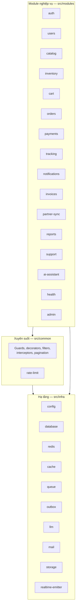

# 02 — Danh sách module

Module được chia thành 3 lớp. Mũi tên phụ thuộc chỉ đi **từ trên xuống**: module nghiệp vụ dùng hạ tầng, hạ tầng không biết gì về nghiệp vụ.



> **Tiến độ:** Giai đoạn 1 đã có `auth` (JWT access 15 phút + refresh token xoay vòng trong cookie httpOnly), `users`, `catalog`, `inventory`, `cart`, `orders` (gồm thanh toán giả lập `POST /orders/:id/pay` và màn hình kho). OTP và voucher làm ở Giai đoạn 2 cùng rate limit. Giỏ hàng lưu ở bảng `cart_items` (khoá chính `user_id, product_id`), không có bảng `carts` riêng.

Ký hiệu cột **Chạy ở**: `A` = tiến trình api, `W` = tiến trình worker.

---

## A. Hạ tầng (`src/infra`)

| Module | Trách nhiệm | Điểm then chốt | Chạy ở |
|--------|-------------|----------------|--------|
| `config` | Đọc + **kiểm tra** biến môi trường khi khởi động (thiếu/sai → dừng ngay) | Schema Joi/Zod; không có giá trị mặc định cho secret | A, W |
| `database` | DataSource TypeORM, migration, seed, helper transaction | `migrationsRun: false` — migration chạy bằng lệnh riêng trước khi deploy | A, W |
| `redis` | Client ioredis dùng chung, cấu hình timeout ngắn, health indicator | `commandTimeout: 100ms`, `enableOfflineQueue: false` để lỗi nhanh thay vì treo | A, W |
| `cache` | `CacheService`: `getOrLoad`, `invalidate`, `bumpVersion`; khoá phân tán, singleflight, cache âm, jitter TTL, circuit breaker, đếm hit/miss | Mọi lỗi Redis bị nuốt + ghi log → fail-open | A, W |
| `queue` | Đăng ký hàng đợi BullMQ, hằng số tên queue/job, cấu hình retry mặc định, chuyển job hết lượt sang `failed_jobs` | `defaultJobOptions: { attempts, backoff: exponential, removeOnComplete }` | A, W |
| `outbox` | `OutboxService.add(tx, event)` (gọi trong transaction); `OutboxRelay` quét & đẩy sang BullMQ | `FOR UPDATE SKIP LOCKED`, quét mỗi 1 s, batch 100 | add: A · relay: W |
| `llm` | `LlmPort` (chat + tool use + structured output); `AnthropicLlmAdapter`; `FakeLlmAdapter` cho test | Timeout 20 s, giới hạn số vòng tool (≤ 5) | A, W |
| `mail` | `MailPort`; `SesMailAdapter` (prod), `SmtpMailAdapter` (Mailpit local); template | — | W |
| `storage` | Lưu file hoá đơn PDF: S3 (prod) / thư mục volume (local) | Khoá file theo `invoiceNumber` → ghi lại không tạo bản thứ hai | W |
| `realtime-emitter` | Phát sự kiện Socket.IO từ worker qua `@socket.io/redis-emitter` | — | W |

## B. Xuyên suốt (`src/common`)

| Thành phần | Nội dung |
|------------|----------|
| Guards | `JwtAuthGuard` (global, bỏ qua với `@Public()`), `RolesGuard` + `@Roles(...)` |
| Decorators | `@CurrentUser()`, `@Public()`, `@Roles()`, `@RateLimit('login' \| 'otp' \| 'promo' \| 'ai')` |
| Filters | `AllExceptionsFilter`: định dạng lỗi thống nhất `{ statusCode, code, message, details? }`, thông điệp tiếng Việt, không lộ stack ra ngoài |
| Interceptors | Gắn `requestId`, đo thời gian xử lý (log + header `Server-Timing`) |
| DTO chung | `PaginationQueryDto` (`page`, `limit ≤ 100`), `PaginatedResult<T>` |
| `rate-limit` | Xem mục C.13 |

## C. Module nghiệp vụ (`src/modules`)

### C.1 `auth` — F06.4, F03
- **Trách nhiệm:** đăng ký, đăng nhập, làm mới token, đăng xuất, gửi/kiểm tra OTP (xác thực email, quên mật khẩu).
- **Endpoint:** `POST /auth/register`, `POST /auth/login` *(hạn mức `login` + khoá leo thang)*, `POST /auth/refresh`, `POST /auth/logout`, `POST /auth/otp/send` *(hạn mức `otp`)*, `POST /auth/otp/verify`.
- **Thiết kế:** access token JWT 15 phút (payload `sub`, `role`); refresh token ngẫu nhiên 7 ngày, lưu **hash** trong DB, **xoay vòng** mỗi lần dùng, phát hiện dùng lại token cũ → thu hồi cả chuỗi. Mật khẩu `argon2`/`bcrypt`. OTP 6 số lưu hash trong Redis TTL 5 phút, tối đa 5 lần nhập sai.
- **Phụ thuộc:** `users`, `rate-limit` (`LoginAttemptService`), `outbox` (job gửi OTP).

### C.2 `users` — F06.4
- **Trách nhiệm:** hồ sơ người dùng, vai trò `CUSTOMER | SUPPORT | WAREHOUSE | ADMIN`; admin tạo tài khoản nhân viên.
- **Endpoint:** `GET/PATCH /me`, `GET/POST /admin/users` *(ADMIN)*.

### C.3 `catalog` — F06.1, F04
- **Trách nhiệm:** danh mục, thương hiệu, sản phẩm; lọc + phân trang; đọc qua cache.
- **Endpoint:** `GET /categories`, `GET /brands`, `GET /products?categoryId&brandId&minPrice&maxPrice&q&sort&page&limit`, `GET /products/:id`; `POST/PATCH /admin/products/:id` *(ADMIN — đổi giá)*.
- **Cache:** `product:{id}` (TTL 600 s), `catalog:list:v{n}:{sha1(bộ lọc đã chuẩn hoá)}` (TTL 300 s). Chuẩn hoá bộ lọc (sắp xếp khoá, bỏ giá trị rỗng) để cùng một truy vấn luôn ra cùng một khoá → tăng tỉ lệ trúng.
- **Khi đổi giá:** commit → `cache.invalidate(product:{id})` + `cache.bumpVersion('catalog')`.
- **Index DB:** `(category_id, price)`, `(brand_id, price)`, `pg_trgm` cho `name` nếu có tìm kiếm.

### C.4 `inventory` — F06.2, F04, F05
- **Trách nhiệm:** tồn kho theo sản phẩm; trừ/hoàn kho nguyên tử; nhân viên kho điều chỉnh tồn; nhận kết quả đồng bộ đối tác.
- **Endpoint:** `GET /inventory/:sku` *(staff)*, `PATCH /inventory/:sku` *(WAREHOUSE — điều chỉnh, ghi `inventory_movements`)*.
- **API nội bộ cho module khác:** `reserve(tx, items)`, `release(tx, items)`, `getBySku(sku)` (dùng cho tool AI).
- **Sau commit:** làm mới cache sản phẩm liên quan; tạo outbox `InventoryChanged` → job `inventory-sync`.

### C.5 `cart` — F06.2
- **Trách nhiệm:** giỏ hàng của khách (lưu DB để không mất khi đổi thiết bị).
- **Endpoint:** `GET /cart`, `PUT /cart/items/:productId { quantity }`, `DELETE /cart/items/:productId`.
- **Quy tắc:** kiểm tra tồn mềm khi thêm vào giỏ (chỉ cảnh báo); kiểm tra cứng nằm ở `orders`.

### C.6 `orders` — F06.2, F06.3, F02, F05
- **Trách nhiệm:** đặt đơn, máy trạng thái đơn, lịch sử đơn, huỷ đơn.
- **Endpoint:**
  - Khách: `POST /orders` *(header `Idempotency-Key`; có `voucherCode` → hạn mức `promo`)*, `GET /orders` (lịch sử của mình), `GET /orders/:id`, `POST /orders/:id/cancel`.
  - Kho: `GET /warehouse/orders?status=`, `PATCH /orders/:id/status` *(WAREHOUSE)*.
- **Máy trạng thái:**
  ```
  PENDING_PAYMENT ─pay─▶ PAID ─▶ PACKING ─▶ SHIPPED ─▶ DELIVERED
        │                 │
        └──── cancel ─────┴──▶ CANCELLED   (hoàn kho trong cùng transaction)
  ```
  Chuyển trạng thái không hợp lệ → 409. Cập nhật dùng `version` (optimistic lock) để hai nhân viên không ghi đè nhau.
- **Sự kiện (outbox):** `OrderPlaced`, `OrderPaid`, `OrderStatusChanged`, `OrderCancelled`. Realtime phát trực tiếp sau commit qua `TrackingPublisher`.
- **Voucher:** bảng `vouchers` đơn giản (mã, % giảm, số lượt còn lại — trừ nguyên tử như tồn kho).
- **Phụ thuộc:** `cart`, `catalog` (đọc giá từ DB), `inventory`, `outbox`, `tracking`.

### C.7 `payments` — F05.4 (giả lập)
- **Trách nhiệm:** mô phỏng thanh toán (không có cổng thật theo phạm vi SRS).
- **Endpoint:** `POST /orders/:id/pay` → tạo `payments` (unique theo `order_id`) và chuyển đơn sang `PAID`.
- **Job:** `payment-reminder` (delay 30 phút, `jobId = payment-reminder:{orderId}`): nếu đơn vẫn `PENDING_PAYMENT` → gửi email nhắc; nếu đã thanh toán → kết thúc không làm gì. *(Tuỳ chọn: tự huỷ sau 24 h.)*

### C.8 `tracking` — F02
- **Trách nhiệm:** gateway Socket.IO namespace `/tracking`.
- **Xác thực:** middleware `io.use()` đọc `handshake.auth.token`, verify JWT → gắn `socket.data.user`; sai → `next(new Error('UNAUTHORIZED'))` (từ chối ngay khi bắt tay, không vào được namespace).
- **Sự kiện client → server:** `order:subscribe { orderId }` (ack `{ ok }` hoặc `{ error: 'FORBIDDEN' }`), `order:unsubscribe`.
- **Sự kiện server → client:** `order:status { orderId, status, changedAt, version }`.
- **Phân quyền:** khách chỉ join được room đơn của mình; SUPPORT/WAREHOUSE/ADMIN join mọi đơn.
- **Hạ tầng:** `@socket.io/redis-adapter` để 2 bản api cùng phát được trong lúc blue/green.
- **Export:** `TrackingPublisher.orderStatusChanged(order)` cho `orders` gọi.

### C.9 `notifications` — F05.1, F05.3
- **Trách nhiệm:** processor hàng đợi `email` (xác nhận đơn, nhắc thanh toán, OTP, báo cáo).
- **Bất biến khi lặp:** trước khi gửi, `INSERT INTO email_logs (type, ref_id) … ON CONFLICT DO NOTHING RETURNING id`; không có dòng trả về → đã gửi rồi → bỏ qua. Ghi `email_logs` + gửi được bọc sao cho lỗi gửi sẽ xoá bản ghi giữ chỗ (trạng thái `SENDING → SENT`) để lần retry gửi lại.
- **Retry:** 5 lần, exponential backoff từ 10 s.

### C.10 `invoices` — F05.1, F05.3
- **Trách nhiệm:** processor `invoice`: sinh PDF (pdfkit), lưu `storage`, ghi bảng `invoices` (unique `order_id`).
- **Endpoint:** `GET /orders/:id/invoice` (URL tải có thời hạn).
- **Retry:** 3 lần, backoff 30 s.

### C.11 `partner-sync` — F05.1, F05.2
- **Trách nhiệm:** processor `inventory-sync`: gọi API đối tác (giả lập bằng `PartnerMockController` có tỉ lệ lỗi cấu hình được) để đồng bộ tồn kho.
- **Bất biến:** gửi header `Idempotency-Key = sync:{productId}:{inventoryVersion}`; đối tác giả lập lưu khoá đã xử lý.
- **Retry:** 8 lần, exponential backoff 5 s → ~10 phút; hết lượt → `failed_jobs` kèm `reason` và payload, admin bấm "Chạy lại".

### C.12 `reports` — F05.4
- **Trách nhiệm:** job lặp `daily-revenue` lúc 00:05 (Asia/Ho_Chi_Minh): tổng hợp doanh thu ngày hôm trước → `daily_revenue_reports` (unique `report_date`) → gửi email admin.
- **Bất biến:** `jobId = daily-revenue:{yyyy-mm-dd}`; upsert theo `report_date`.

### C.13 `rate-limit` — F03
- **Trách nhiệm:** cấu hình throttler, guard, xử lý 429, chống dò mật khẩu.
- **Hạn mức (đề xuất — chỉnh khi đo tải):**

  | Tên | Áp dụng | Giới hạn | Khoá đếm |
  |-----|---------|----------|----------|
  | `default` | Toàn bộ API | 120 req / 60 s | `user:{id}` nếu có JWT, ngược lại `ip:{ip}` |
  | `login` | `POST /auth/login` | 10 req / 60 s | IP |
  | `otp` | `POST /auth/otp/send` | 1 req / 60 s **và** 5 req / giờ | email/tài khoản đích + IP |
  | `promo` | `POST /orders` có voucher | 3 req / 60 s | user |
  | `ai` | `POST /assistant/chat` | 20 req / 60 s | user (bảo vệ chi phí LLM) |

- **`UserOrIpThrottlerGuard`:** ghi đè `getTracker()`; IP lấy từ `X-Forwarded-For` qua `app.set('trust proxy', 1)` (chỉ tin Nginx).
- **429:** header `Retry-After`, body `{ statusCode: 429, code: 'TOO_MANY_REQUESTS', message: 'Bạn thao tác quá nhanh. Vui lòng thử lại sau 42 giây.', retryAfter: 42 }`.
- **`LoginAttemptService` (khoá leo thang theo tài khoản mục tiêu):** đếm lần sai theo `login:fail:{email}` (TTL 24 h, kể cả email không tồn tại để không lộ tài khoản nào có thật).
  5 lần sai → khoá 1 phút, 10 → 5 phút, 15 → 30 phút, 20+ → 24 giờ + email cảnh báo chủ tài khoản. Đăng nhập đúng → xoá bộ đếm. Kiểm tra khoá **trước** khi so mật khẩu.
- **Redis lỗi:** chuyển sang bộ đếm trong bộ nhớ của tiến trình (vẫn chặn được, chỉ kém chính xác giữa các bản).

### C.14 `support` — F01
- **Trách nhiệm:** ticket + tin nhắn giữa khách và CSKH.
- **Endpoint:** khách `POST /tickets`, `GET /tickets`, `POST /tickets/:id/messages`; nhân viên `GET /support/tickets?category&status`, `PATCH /support/tickets/:id` (gán, đổi nhóm, đóng).
- **Sự kiện:** `TicketCreated` (outbox) → job `ai-classify`.

### C.15 `ai-assistant` — F01
- **Trách nhiệm:** phân loại ticket; trợ lý chat cho nhân viên CSKH có tool; quản lý đề xuất hành động.
- **Nhóm phân loại:** `ORDER_STATUS`, `SHIPPING`, `PAYMENT`, `RETURN_REFUND`, `PRODUCT_INFO`, `ACCOUNT`, `OTHER` (+ `UNCLASSIFIED` khi lỗi/độ tin cậy < 0,6).
- **Tool:**

  | Tool | Loại | Gọi tới |
  |------|------|---------|
  | `get_order_status(order_code)` | Đọc | `OrdersService.getForStaff` |
  | `check_inventory(sku)` | Đọc | `InventoryService.getBySku` |
  | `propose_action(type, order_code, reason)` | **Chỉ đề xuất** | Ghi `agent_actions` trạng thái `PROPOSED` |

- **Endpoint:** `POST /assistant/chat`, `GET /assistant/actions?status=PROPOSED`, `POST /assistant/actions/:id/approve`, `POST /assistant/actions/:id/reject` *(SUPPORT)*.
- **Rào chắn:**
  1. System prompt: chỉ trả lời về ShopFast; câu ngoài phạm vi → mẫu từ chối lịch sự; **không được nêu bất kỳ thông tin đơn nào chưa lấy từ tool**.
  2. Kiểm tra đầu ra: regex mã đơn trong câu trả lời phải xuất hiện trong `tool_result` của lượt đó, nếu không → thay bằng "Tôi cần tra cứu đơn trước khi trả lời".
  3. Nội dung ticket của khách đưa vào prompt trong khối dữ liệu có đánh dấu, không phải chỉ dẫn (chống prompt injection).
  4. Không tool nào có quyền ghi; hành động chỉ chạy khi nhân viên bấm duyệt, thực thi bằng danh tính nhân viên, ghi `audit_logs`.
- **Lưu vết:** mỗi lượt chat lưu vào `assistant_messages` (dùng để xem lại và đánh giá).

### C.16 `health` — F07.1
- `GET /health/live` → tiến trình còn sống (Docker healthcheck).
- `GET /health/ready` → `{ status: 'ok' | 'degraded' | 'down', info: { database, redis } }` (`@nestjs/terminus`). DB lỗi → 503; chỉ Redis lỗi → 200 + `degraded` (vẫn phục vụ được).

### C.17 `admin` — F07.2
- `GET /admin/queues/stats` → mỗi queue: `waiting, active, completed, failed, delayed` (`queue.getJobCounts()`).
- `GET /admin/failed-jobs`, `POST /admin/failed-jobs/:id/retry`.
- `GET /admin/cache/stats` → hit, miss, tỉ lệ trúng (chứng minh ≥ 80%).
- Bull Board mount tại `/admin/bull` (chỉ ADMIN — kiểm tra JWT qua cookie httpOnly, hoặc Nginx giới hạn IP quản trị).

## D. Web (`apps/web`)

| Khu vực | Màn hình | Vai trò |
|---------|----------|---------|
| Cửa hàng | Danh sách sản phẩm + bộ lọc, chi tiết, giỏ hàng, thanh toán | CUSTOMER |
| Tài khoản | Đăng nhập/đăng ký/OTP, lịch sử đơn, **theo dõi đơn realtime**, ticket hỗ trợ | CUSTOMER |
| CSKH | Hộp ticket theo nhóm, **khung trợ lý AI**, danh sách đề xuất chờ duyệt | SUPPORT |
| Kho | Danh sách đơn theo trạng thái, đổi trạng thái, điều chỉnh tồn | WAREHOUSE |
| Quản trị | Sức khoẻ hệ thống, thống kê hàng đợi + job thất bại, thống kê cache, sản phẩm/giá | ADMIN |

Thành phần dùng chung: `ApiClient` (tự gắn token, tự refresh khi 401, hiển thị thông điệp 429), hook `useOrderTracking(orderId)` (kết nối, đăng ký lại khi `connect`, gọi lại REST để bù sự kiện lỡ), bộ token giao diện (màu, khoảng cách 4/8/12/16/24/32/48/64, bo góc 2 mức) khai báo một chỗ trong cấu hình Tailwind.
Mỗi danh sách có đủ trạng thái: đang tải (skeleton), rỗng (giải thích + nút hành động), lỗi (nói rõ lỗi + nút thử lại).
