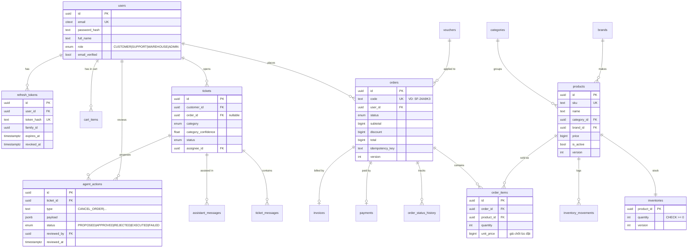

# 03 — Mô hình dữ liệu

Quy ước: khoá chính `id uuid` (trừ khi ghi chú), cột `created_at`, `updated_at timestamptz`, tiền tệ lưu `bigint` theo **đồng** (không dùng float), tên bảng số nhiều `snake_case`.

## 1. Sơ đồ quan hệ



## 2. Bảng phục vụ hạ tầng / độ tin cậy

| Bảng | Cột chính | Mục đích |
|------|-----------|----------|
| `outbox_events` | `id bigserial`, `aggregate_type`, `aggregate_id`, `event_type`, `payload jsonb`, `created_at`, `published_at null`, `attempts` | Transactional outbox (F05). Index một phần `WHERE published_at IS NULL` |
| `email_logs` | `id`, `type`, `ref_id`, `recipient`, `status (SENDING/SENT)`, `provider_message_id` | **Unique `(type, ref_id)`** → khách nhận đúng 1 email cho mỗi đơn |
| `failed_jobs` | `id`, `queue`, `job_name`, `job_id`, `payload jsonb`, `reason`, `stacktrace`, `attempts_made`, `failed_at`, `retried_at` | Dead-letter — job hết lượt thử kèm lý do |
| `invoices` | `id`, `order_id` **UK**, `invoice_number` **UK**, `file_key` | Một đơn một hoá đơn |
| `payments` | `id`, `order_id` **UK**, `amount`, `method`, `paid_at` | Một đơn một lần thanh toán |
| `daily_revenue_reports` | `report_date` **PK**, `order_count`, `revenue`, `sent_at` | Báo cáo đêm idempotent |
| `inventory_movements` | `id`, `product_id`, `delta`, `reason (ORDER/CANCEL/ADJUST/SYNC)`, `ref_id`, `actor_id` | Truy vết mọi thay đổi tồn kho |
| `partner_sync_logs` | `idempotency_key` **UK**, `status`, `response` | Đối tác giả lập ghi nhận khoá đã xử lý |
| `audit_logs` | `id`, `actor_id`, `action`, `entity`, `entity_id`, `before jsonb`, `after jsonb` | Ai đổi giá, ai duyệt hành động AI, ai đổi trạng thái đơn |
| `assistant_messages` | `id`, `ticket_id`, `staff_id`, `role`, `content`, `tool_calls jsonb` | Lưu vết hội thoại với trợ lý AI |
| `vouchers` | `code` **PK**, `percent_off`, `remaining_uses CHECK >= 0`, `starts_at`, `ends_at` | Đơn khuyến mãi |

## 3. Ràng buộc bảo đảm tính đúng

| Rủi ro | Ràng buộc / kỹ thuật |
|--------|----------------------|
| Bán vượt tồn kho | `inventories.quantity CHECK (quantity >= 0)` + `UPDATE … SET quantity = quantity - :n WHERE product_id = :id AND quantity >= :n` (kiểm tra số dòng ảnh hưởng). CHECK là lưới an toàn cuối cùng |
| Voucher dùng quá số lượt | Như trên với `remaining_uses` |
| Khách bấm đặt 2 lần | `UNIQUE (user_id, idempotency_key)` trên `orders` |
| Hai nhân viên kho ghi đè trạng thái | `orders.version` (optimistic lock) + máy trạng thái kiểm tra trạng thái nguồn |
| Gửi trùng email / hoá đơn / thanh toán | Unique `(type, ref_id)`, `invoices.order_id`, `payments.order_id` |
| Báo giá cũ | `order_items.unit_price` chụp giá từ DB tại thời điểm đặt, không lấy từ cache hay client |
| Refresh token bị đánh cắp | Xoay vòng theo `family_id`; dùng lại token đã xoay → thu hồi cả family |

## 4. Index chính

```sql
CREATE INDEX ON products (category_id, price) WHERE is_active;
CREATE INDEX ON products (brand_id, price)    WHERE is_active;
CREATE INDEX ON orders (user_id, created_at DESC);
CREATE INDEX ON orders (status, created_at)   ; -- màn hình kho, job nhắc thanh toán, báo cáo
CREATE INDEX ON outbox_events (id) WHERE published_at IS NULL;
CREATE INDEX ON tickets (category, status);
```

## 5. Migration & seed

- Migration TypeORM sinh bằng `pnpm --filter api migration:generate`, review thủ công, commit cùng PR.
- **Migration phải tương thích ngược (expand → contract)** vì trong lúc blue/green, bản cũ vẫn chạy với schema mới:
  thêm cột nullable → deploy code dùng cột → backfill → đặt NOT NULL ở lần deploy sau. Không đổi tên/xoá cột trong cùng một lần deploy.
- `seed` tạo: 4 tài khoản demo (mỗi vai trò 1), 200 khách, 20 danh mục, 50 thương hiệu, 1.000 sản phẩm, 5.000 đơn rải trong 60 ngày (để báo cáo doanh thu có dữ liệu), 30 ticket mẫu. Seed dùng `@faker-js/faker` với seed cố định → dữ liệu lặp lại được.
