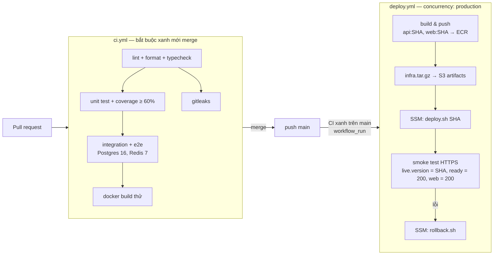

# 05 — Triển khai, CI/CD & vận hành

## 1. Môi trường

| Môi trường | Ở đâu | Dữ liệu | Dùng để |
|------------|-------|---------|---------|
| local | Docker Compose trên máy dev | seed | Phát triển; Mailpit bắt email |
| CI | GitHub Actions runner | Service container Postgres/Redis rỗng | Kiểm thử |
| production (kiêm staging) | EC2 + domain HTTPS | seed + dữ liệu demo | Demo, Swagger `/api/docs` |

> Nếu đủ chi phí: thêm `staging.<domain>` trên cùng EC2 (compose project riêng) và cho `deploy.yml` triển khai staging trước, production sau khi duyệt. Swagger chỉ bật ở staging (`SWAGGER_ENABLED`).

## 2. Pipeline



`deploy.yml` chỉ chạy khi `ci.yml` **thành công trên `main`** (sự kiện `workflow_run`), hoặc chạy tay (`workflow_dispatch`) để triển khai lại một SHA cũ.
Compose, cấu hình Nginx và script của đúng commit đó được đóng gói `infra.tar.gz`, đẩy lên S3 `shopfast-artifacts-*`; EC2 tải về `/opt/shopfast/releases/<sha>/` → mã hạ tầng luôn khớp phiên bản ứng dụng, CI không cần SSH hay git trên máy chủ.

**Mục tiêu < 10 phút:** cache layer Docker (`cache-from/cache-to: type=gha`), cache pnpm store, chạy song song lint/test, image `node:20-alpine` nhỏ. Ước tính: build + push ~3', deploy ~2', smoke ~30''.

**Bằng chứng cần lưu cho hội đồng:** link lịch sử Actions có (1) các lần chạy xanh, (2) một PR bị chặn vì test hỏng, (3) một lần deploy tự quay lui.

### Gắn thẻ image
- Mỗi image gắn `:<git-sha>` (bất biến, ECR bật *tag immutability*). Không dùng `latest` trên production.
- Nhãn OCI `org.opencontainers.image.revision=<sha>`, `source=<repo-url>` → từ container đang chạy truy ngược ra commit.
- `GET /api/health/live` trả `version: <sha>` để demo đang chạy bản nào.

## 3. Triển khai blue/green không gián đoạn (`deploy.sh <sha>`)

Bố cục trên EC2 (chú thích đầy đủ ở đầu [`infra/scripts/lib.sh`](../infra/scripts/lib.sh)):
```
/opt/shopfast/host.env          cấu hình không bí mật của máy (region, registry, domain, bucket)
/opt/shopfast/releases/<sha>/   gói hạ tầng của từng commit;  current → bản đang phục vụ
/opt/shopfast/shared/           .env + datastore.env (secret, 600), deploy.env (tag image),
                                state/ (màu đang chạy, màu trước), nginx/, web/releases/<sha>, web/current
```

Các bước của [`deploy.sh`](../infra/scripts/deploy.sh):
```
1. render-env.sh                     secret từ SSM → shared/.env (api, worker) và shared/datastore.env (pg, redis)
2. docker pull api:<sha>, web:<sha>  bằng instance role (ECR)
3. Cài cấu hình dùng chung           nginx.conf, shopfast.conf (thay __DOMAIN__), postgres-init
4. compose up --no-recreate postgres redis
                                     deploy KHÔNG BAO GIỜ khởi động lại data store
5. Migration                         docker run --rm api:<sha> node dist/infra/database/migrate.js
                                     → lỗi: dừng, bản đang chạy không bị đụng tới
6. Màu rảnh = màu còn lại của state/active_color; khởi động api-<rảnh>
7. Chờ HEALTHCHECK (/api/health/ready) healthy, tối đa 90 s
                                     → lỗi: dừng api-<rảnh>, thoát ≠ 0 — traffic chưa từng chuyển
8. publish_web: chép web tĩnh ra shared/web/releases/<sha>, đổi symlink current (nguyên tử)
9. Ghi upstream.d/active.conf = api-<rảnh>; nginx -t && nginx -s reload
                                     reload giữ kết nối cũ đến khi xong, kết nối mới sang bản mới
10. Ghi state (active/previous), trỏ /opt/shopfast/current
11. Worker: compose up -d worker     SIGTERM worker cũ (chờ job đang chạy ≤ 30 s) rồi chạy worker mới.
                                     Job chờ vài giây trong Redis — người dùng không thấy gì
12. Bản api cũ VẪN CHẠY (nhàn rỗi) đến lần deploy sau → rollback chỉ là một lần reload Nginx
```

**Đã kiểm chứng cục bộ:** chuyển blue → green rồi dừng blue trong lúc gửi 300 request liên tục qua Nginx HTTPS → 300/300 trả 200.

**Vì sao web tĩnh không nằm trong container Nginx:** nếu mỗi lần deploy phải tạo lại container Nginx thì mọi kết nối đang mở bị cắt. Nginx chạy lâu dài với image chính thức; mỗi bản web là một thư mục, chuyển bằng symlink.

**Socket đang mở:** kết nối WebSocket cũ vẫn ở bản cũ (nhận sự kiện qua Redis adapter) cho tới khi Nginx đóng worker cũ (`worker_shutdown_timeout 30s`) hoặc bản cũ bị thay ở lần deploy sau; client Socket.IO tự kết nối lại, gửi lại `order:subscribe` và gọi REST bù → khách không cần tải lại trang.

**Graceful shutdown:** `SIGTERM` → ngừng nhận request → chờ request đang chạy (≤ 25 s) → đóng DB/Redis → thoát. `stop_grace_period: 30s` trong compose.

## 4. Quay lui (mục tiêu < 2 phút)

| Thời điểm phát hiện lỗi | Cách quay lui | Thời gian |
|-------------------------|---------------|-----------|
| Health check bước 7 | Không chuyển traffic; dừng bản mới | 0 (không ảnh hưởng) |
| Smoke test sau khi chuyển (pipeline tự gọi) | `rollback.sh`: màu trước vẫn chạy → đổi symlink web + trỏ upstream về màu cũ, reload Nginx | vài giây |
| Phát hiện muộn, màu trước không còn khoẻ | `rollback.sh` tự chuyển sang chạy lại `deploy.sh <previous_sha>` từ gói release đã giữ (5 bản gần nhất, image có sẵn trên máy) | ~60–90 s |
| Muốn về một commit bất kỳ | Actions → Deploy → Run workflow với `sha` | như một lần deploy |

Không rollback migration: nhờ quy tắc expand → contract, bản cũ chạy được với schema mới.

Diễn tập trước buổi bảo vệ: merge một commit làm `/health/ready` trả 503 → quan sát pipeline tự quay lui, ghi thời gian.

## 5. Bảo mật hạ tầng

### 5.1 Không có khoá dài hạn

| Chủ thể | Cách xác thực với AWS | Quyền (đặc quyền tối thiểu) |
|---------|------------------------|-----------------------------|
| GitHub Actions | **OIDC** → `AssumeRoleWithWebIdentity` vào `shopfast-gha-deploy`. Trust policy chỉ chấp nhận `sub = repo:<owner>/<repo>:environment:production` | Push ECR vào đúng 2 repo `shopfast/api`, `shopfast/web`; `s3:PutObject` vào `shopfast-artifacts-*/releases/*`; `ssm:SendCommand` chỉ với instance có tag `app=shopfast` và document `AWS-RunShellScript`; `ssm:GetCommandInvocation`. Policy: [`infra/aws/iam/`](../infra/aws/iam/) |
| EC2 (app, backup) | **Instance profile** `shopfast-ec2` — thông tin tạm thời tự xoay vòng qua IMDSv2 | ECR pull; `ssm:GetParameter*` trên `/shopfast/prod/*`; `s3:GetObject` gói release; `s3:PutObject` vào `shopfast-backups-*/daily/*` (**không có quyền xoá**); `cloudwatch:PutMetricData` namespace `ShopFast`; `AmazonSSMManagedInstanceCore`. Thêm `ses:SendEmail` ở giai đoạn 3 |
| Con người | IAM user trong **group** (`Admins`, `Developers`), **bắt buộc MFA**, không dùng root | Theo group; tài khoản root khoá MFA, không có access key |

Bật IMDSv2 bắt buộc (`HttpTokens=required`) để chặn SSRF lấy credential.

### 5.2 Secrets
- Lưu ở SSM Parameter Store, kiểu SecureString: `/shopfast/prod/DATABASE_PASSWORD`, `JWT_ACCESS_SECRET`, `JWT_REFRESH_SECRET`, `LLM_API_KEY`, `REDIS_PASSWORD`…
- `render-env.sh` chạy trên EC2 bằng instance role, ghi `shared/.env` (api, worker) và `shared/datastore.env` (chỉ mật khẩu Postgres/Redis) quyền `600`. Tách hai file để thêm secret cho ứng dụng không làm Compose tạo lại container dữ liệu.
- Không secret nào trong: mã nguồn, `Dockerfile` (không `ARG`/`ENV` chứa secret), `docker-compose*.yml`, workflow. GitHub chỉ giữ **biến không nhạy cảm** (`AWS_ROLE_ARN`, `AWS_REGION`, `ECR_REGISTRY`, `INSTANCE_ID`).
- CI chạy `gitleaks` chặn PR có chuỗi giống secret. `.dockerignore` loại `.env*`.

### 5.3 Mạng
- Security group: `80, 443 ← 0.0.0.0/0`; `22 ← <IP quản trị>/32`. Không mở 5432/6379/3000.
- Compose production **không khai báo `ports:`** cho api/worker/pg/redis. Redis bật `requirepass`, PostgreSQL user ứng dụng không phải superuser.
- Nginx: `return 301 https://…` ở cổng 80; TLS 1.2+; HSTS; `client_max_body_size`; header bảo mật cơ bản; `proxy_set_header X-Forwarded-For`; upgrade WebSocket cho `/socket.io/`.
- Chứng chỉ Let's Encrypt gia hạn tự động (certbot timer + `nginx -s reload`).

## 6. Sao lưu & khôi phục

**Sao lưu (`backup.sh`, cron 02:00 hằng ngày trên EC2):**
```
docker exec pg pg_dump -Fc -U shopfast shopfast > /tmp/shopfast-<date>.dump
aws s3 cp … s3://shopfast-backups-<account>/daily/shopfast-<date>.dump --sse aws:kms
ghi log + đẩy metric "BackupSucceeded" lên CloudWatch (alarm nếu 26 h không có)
```
- Bucket: versioning bật, chặn public access, lifecycle 30 ngày → Glacier, 90 ngày xoá. Instance role chỉ có quyền ghi, **không có quyền xoá** → máy chủ bị chiếm cũng không xoá được bản sao lưu.
- "Nơi tách biệt": S3 là dịch vụ khác, nằm ngoài EC2/EBS; mất máy chủ không mất bản sao lưu.

**Diễn tập khôi phục (`restore.sh`, bắt buộc làm thật ít nhất 1 lần, mục tiêu < 30 phút):**
1. Dựng container `pg-restore` mới (hoặc EC2 mới từ đầu nếu muốn diễn tập thảm hoạ).
2. Tải bản sao lưu mới nhất từ S3, `pg_restore --clean --if-exists`.
3. Đối chiếu số dòng các bảng chính với số liệu ghi lúc sao lưu; chạy truy vấn mẫu (đơn mới nhất).
4. Ghi biên bản `docs/runbooks/restore-drill-<yyyy-mm-dd>.md`: thời điểm bắt đầu/kết thúc, kích thước bản sao lưu, kết quả đối chiếu, vấn đề gặp phải. **RPO** = 24 h (sao lưu hằng ngày), **RTO** đo được.

## 7. Giám sát

| Gì | Công cụ | Ngưỡng cảnh báo |
|----|---------|-----------------|
| Sống/chết từ bên ngoài | UptimeRobot / CloudWatch Synthetics gọi `https://<domain>/api/health/ready` mỗi 1 phút | 2 lần liên tiếp lỗi → email |
| Máy chủ | CloudWatch: CPU, `StatusCheckFailed`, dung lượng đĩa (CloudWatch agent) | CPU > 80% 10', đĩa > 80% |
| Log | Docker `awslogs` driver → CloudWatch Logs (group `/shopfast/api`, `/shopfast/worker`) | Metric filter `level=error` > 20/5' |
| Hàng đợi | Trang admin + Bull Board | `failed_jobs` tăng → hiển thị đỏ trên trang admin |
| Cache | `/admin/cache/stats` | Tỉ lệ trúng < 80% |
| Sao lưu | Metric `BackupSucceeded` | Không có trong 26 h |

## 8. Runbook (đặt trong `docs/runbooks/`)
- `deploy-and-rollback.md` — triển khai tay khi Actions có sự cố, quay lui tay.
- `restore-from-backup.md` — các bước khôi phục.
- `redis-down.md`, `db-down.md`, `llm-down.md` — dấu hiệu, ảnh hưởng, cách xử lý.
- `rotate-secret.md` — đổi một secret trong SSM rồi deploy lại cùng SHA.
